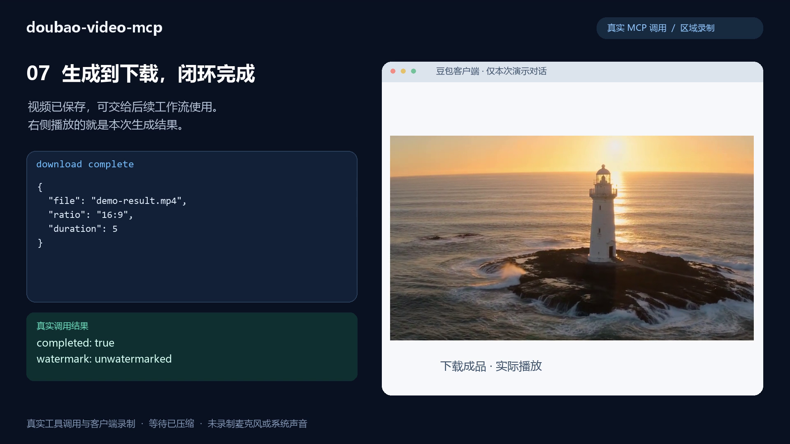

# doubao-video-mcp

[npm 安装包](https://www.npmjs.com/package/doubao-video-mcp) · [GitHub 源码](https://github.com/ouyearllla/doubao-video-mcp)

通过 MCP，让 AI Agent 直接操作本机豆包桌面客户端，**生成、查询和下载视频**。支持自选模型、比例与时长，优先下载无水印版，也能恢复已有任务。

适用于 Codex、CodeBuddy、WorkBuddy，以及其他支持 **stdio MCP** 的客户端。非豆包官方产品，使用你自己的账号与额度。

**需要：Windows 桌面环境、Node.js 22+、豆包桌面客户端。**

## 36 秒演示

[](https://github.com/ouyearllla/doubao-video-mcp/blob/main/docs/demo.mp4)

**[观看 / 下载演示视频](https://github.com/ouyearllla/doubao-video-mcp/blob/main/docs/demo.mp4)**：设置参数 → 写入提示词 → 提交确认 → 查询进度 → 下载 → 播放成品。

真实 MCP 调用与客户端录制，等待过程已压缩，个人信息已隐藏。示例生成 5 秒海景视频，实际参数可自行设置。

## 安装

```powershell
npm install -g doubao-video-mcp
```

选择你的客户端，执行对应命令：

| 客户端 | 配置命令 |
|---|---|
| Codex | `doubao-video setup --client codex` |
| CodeBuddy | `doubao-video setup --client codebuddy --skip-skill` |
| WorkBuddy / 其他支持 stdio MCP 的客户端 | `doubao-video setup --client generic --skip-skill` |

Codex 自动注册。其他客户端请将命令生成的 JSON 配置导入 MCP 设置；WorkBuddy 中还需信任并启用 `doubao`。完成后重新连接 MCP。

MCP 负责连接豆包、生成与下载；配套 Skill 提供调用流程，按需安装。需要 Skill 时，用 `--skill-dir "你的客户端技能目录"` 替代 `--skip-skill`。

## 使用

在 Agent 中说：

> 用豆包生成 stir 的英语场景视频，Mini 模型，9:16，10 秒，优先下载无水印版。

- 支持选择模型、比例和时长；默认 Fast、16:9、15 秒，实际选项以豆包为准。
- 优先下载无水印版，不可用时退回普通版并说明；必须无水印时使用 `require_clean:true`。
- 支持任务查询、恢复和下载；同一请求编号不会重复提交生成。
- 生成可能消耗账号额度；安装、配置和自检不会生成视频。

视频默认保存在 `下载/DoubaoVideos`，运行代码和任务记录保存在 `~/.doubao-video-mcp`。包内不含账号、Cookie、登录配置或历史视频。

## 升级

```powershell
npm install -g doubao-video-mcp@latest
doubao-video setup --client generic --skip-skill
```

Codex 用户将第二条改为 `doubao-video setup --client codex`。自定义安装目录时沿用原来的 `--install-dir`。

**必须重新运行 setup，并在客户端断开、重新连接豆包 MCP。仅更新 npm 包不会更新正在使用的运行代码。** 任务记录保留；使用同一稳定入口时无需重新导入配置。

## 遇到问题

| 情况 | 处理方法 |
|---|---|
| 手动打开的豆包无法连接 | 从托盘完整退出一次，再调用 `doubao_connect`；登录过期时正常登录 |
| 启动白屏或超时 | 升级并重连 MCP，只调用 `doubao_connect`；不要让 Agent 改用 Bash 直接启动豆包 |
| 找不到安装位置 | setup 时加 `--doubao-exe "D:\Apps\Doubao\app\Doubao.exe"` |
| 检查安装与连接 | 执行 `doubao-video doctor`；自定义目录加 `--install-dir` |

更多命令：`doubao-video --help`；工具列表：`doubao-video tools`；调用示例见 `examples/`。

## 1.2.2 更新

改由 Windows 桌面启动豆包，减少宿主临时工具环境对启动的影响。新启动的连接结果包含 `launch.launch_method: windows_desktop_shell`；复用现有窗口时返回 `client_reused:true`。

本机桌面启动与 41 项自动化测试通过；WorkBuddy 宿主内的最终验收尚待确认，不能保证所有白屏原因都已解决。

## 开发

```powershell
git clone https://github.com/ouyearllla/doubao-video-mcp.git
cd doubao-video-mcp
npm test
npm run check
```

无第三方运行依赖。测试使用模拟数据，不生成视频。运行入口在 `bin/`，MCP 在 `mcp/`，桌面连接在 `bridge/`，配套 Skill 在 `skills/`。

MIT 许可证，见 [LICENSE](LICENSE)。维护者发布步骤见 [PUBLISHING.md](PUBLISHING.md)。
